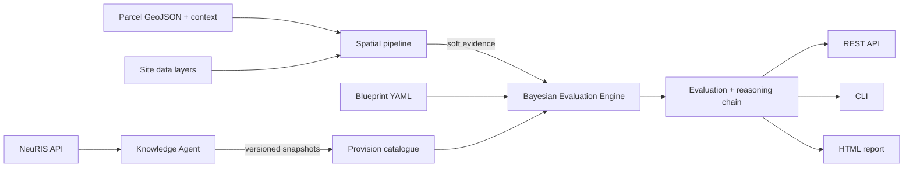

# Architecture and roadmap

This document maps the code to the seven components described in the GECAA
application (Google.org Impact Challenge, April 2026) and lists the
open-source building blocks planned for each.

## Design principles

1. **Every claim is traceable.** Each node in a blueprint names the
   provisions that justify it; each provision carries its source and, once
   fetched, a hashed snapshot of the exact text used.
2. **Uncertainty is shown, not hidden.** Site data enters as probabilities.
   The result states how certain it is and which check would change it most.
3. **Deterministic where the law is, probabilistic where experts are.** Rule
   tables give a single state where a statute or standard fixes a threshold,
   and a distribution only where the relationship is genuinely uncertain.
4. **Open and self-hostable.** Only permissively licensed libraries are
   bundled, so the project can be released under Apache-2.0 and run on
   European infrastructure without any proprietary service.
5. **Decision support only.** Reports say so on every page.

## Data flow



## Components

| # | Component (application) | Status in this repo | Next open-source building blocks |
|---|---|---|---|
| 1 | Knowledge Agent | NeuRIS client, paragraph extraction, append-only snapshots with SHA-256 and change events | changedetection.io and Scrapy for state portals without an API; EUR-Lex via SPARQL; LangExtract for structured extraction with source spans; Prefect for scheduled polling |
| 2 | Bayesian Evaluation Engine | Blueprint YAML compiled to pgmpy networks; soft evidence; sensitivity analysis naming the decisive check | PreliZ for expert elicitation of uncertain tables; PyMC for updating from recorded outcomes; MLflow for versioning blueprints |
| 3 | Spatial pipeline | kf, groundwater, slope and water protection zones from local rasters and GeoJSON | STAC tools (odc-stac) or openEO on Copernicus Data Space instead of Earth Engine; WhiteboxTools for terrain and sinks; xPlanBox for development plans as constraint overlays |
| 4 | Government interface | HTML report with numbered citations | KERN UX components; Typst for print-ready PDFs; a plain-language question interface on an EU-hosted model (Mistral or EuroLLM via vLLM) |
| 5 | Bring Your Own Context | Not started | Docling and OCRmyPDF for uploaded plans and concepts; pgvector for retrieval; per-municipality isolation |
| 6 | REST API | FastAPI with OpenAPI docs | Authentication with Keycloak; OGC API Processes via pygeoapi for the spatial checks |
| 7 | Regulatory Knowledge Schema | LinkML schema, draft 0.1 | Alignment with LDML.de / Akoma Ntoso identifiers and W3C PROV; publish JSON Schema and RDF |

## Version 2: K3 logic engine and live NRW data

| Module | Role |
|---|---|
| `k3/model.py`, `k3/engine.py` | K3 logic: inputs, parameters (PAxx), calculations (CAxx), checks (CHxx) with PASSED / OPEN / BLOCKED; unit and site aggregation (PARTLY = teilweise versickerbar); Monte Carlo probability as extra detail only |
| `k3/service.py` | Builds each evaluation unit (location + catchment), fetches inputs from a geodata provider, user values override map values |
| `geodata/nrw.py` | Live NRW provider: ALKIS WFS (GML parsed directly), BK50 and WSG via WMS GetFeatureInfo; answers cached for 7 days in `data/cache/nrw` |
| `geodata/synthetic.py` | Offline provider on the demo data, for tests |
| `report/k3_render.py` | German report, sections 0–6 |
| `api_v2.py`, `web/v2.*` | `/v2` REST endpoints and the German start page |

Known gaps in v2: no open statewide service for contaminated sites or for depth to
groundwater at site scale (BK50 classes are used and marked "abgeleitet"); BK50 is often
empty in sealed city centres, so kf and groundwater stay OPEN there; the WSG query uses one
point per location; the DGM1 WCS (slope, sinks) is not used yet.

## Version 3: climate risk

```
browser (app.html, v2.js, risk.js, charts.js)
   │  /v2 permit check            /v3/risk/rain · /v3/heat · /v3/cra
   ▼
GECAA (Apache-2.0, FastAPI) ── risk/chain.py ── hydrology.py (priority-flood, D8, cascade, Manning)
   │        │                               ├─ kostra.py (DWD)       ├─ damage.py (JRC/CLIMAAX)
   │        │                               ├─ scenario.py (CLIMAAX) └─ raster_png.py (map overlays)
   │        └─ geodata/nrw.py: DGM1 WCS, ALKIS WFS, BK50/WSG/Klimaanalyse/BKG WMS
   │  JSON only
   ▼
services/climada_worker (GPL-3.0, own venv): CLIMADA Hazard, Exposures, ImpactCalc, CostBenefit
```

Data formats verified against the live services with `scripts/probe_sources.py`, `probe_kostra.py`,
`probe_bkg.py` (KOSTRA grid is EPSG:3035, DWD hot days EPSG:31467, BKG depth in cm).

## Roadmap for the next slices

1. **Expert review of the swale-trench blueprint** with the regulatory domain
   expert, then benchmark against real past cases from partner municipalities.
2. **Better groundwater data:** derive depth from the LANUK groundwater surface
   (GW-Gleichen 2006–2015) minus DGM1 instead of BK50 classes.
3. **Development plan** (XPlanung) and distances to parcel boundaries as further checks.
4. **A second measure** (green roof or tree pit) to prove blueprints generalise.
5. **Costs and funding matching** with 20-year maintenance projections.
6. **KERN-based web interface** and PDF export of the German report.

## Licence rule for contributions

Code that is imported into GECAA must be permissively licensed (MIT, BSD,
Apache-2.0, PostgreSQL, MPL for unmodified files). GPL or AGPL software
(for example PostGIS, GeoServer, Neo4j, GRASS) may be used only as a separate
service that GECAA talks to over a network interface, never imported.
